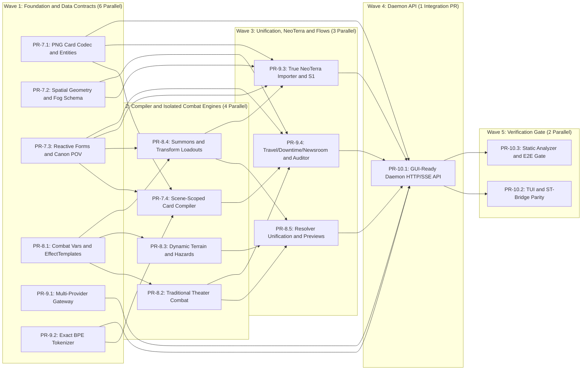

# Referee — Pre-GUI Pass Implementation Plan (Milestones 7–10)

- **Companion Design Documents:**
  - [rp-engine-findings-and-design.md](./rp-engine-findings-and-design.md)
  - [rp-engine-implementation-plan.md](./rp-engine-implementation-plan.md) (Milestones M1–M6 baseline)
- **Target Runtime:** Node.js 22+ / TypeScript 5.x (ESM, zero-DOM headless engine core, cross-platform Windows/Linux/macOS/Termux)
- **Scope:** Tier 1 (Must-Have Pre-GUI Contracts, Lossless `.png` Character Cards, Canon-Faithful `NeoTerra` Import & `neoterra-s1` Rebuild, Multi-Provider Gateway, Exact BPE Tokenization, GUI-Ready Daemon APIs) + Tier 2 (Reactive `form-rules`, `@variable` Scaling, Cached `EffectTemplate`s, Living-World Flows & Post-Turn `Auditor`) + Full Combat Expansion (**Traditional Theater Combat**, **Dynamic Terrain Changes**, **Combat Summons**, **Multi-Stage Transformation Loadouts**, and **Pre-Commit Action Previews**).
- **License Hygiene (F-9):** All combat mechanics and preview engines are authored clean-room in TypeScript (`Combat-Multihog` is GPL v3 and used strictly as a black-box behavioral specification; `NeoTerra-Framework` is MIT).

---

## 0. Global Execution & Parallelization Matrix

This pre-GUI pass breaks the remaining engine, `.png` card, `NeoTerra`, combat, and daemon work into **4 Milestones (M7–M10)** and **15 PR-sized steps** arranged across **5 Parallel Execution Waves**.

```text
Wave 1 (Foundation & Data Contracts — 6 Concurrent PRs)
  ├── PR-7.1 (Lossless .png Card Codec, Binary Assets & Card-Backed Entities)
  ├── PR-7.2 (LocationEntity v2: Spatial Geometry & Dungeon Reality Fog-of-War)
  ├── PR-7.3 (Reactive form-rules & Canon Character Player Takeover)
  ├── PR-8.1 (Combat Core: @variable Scaling, Crits, Willpower-Break & EffectTemplates)
  ├── PR-9.1 (Native Multi-Provider Gateway: Anthropic, Gemini, Ollama & Presets)
  └── PR-9.2 (Exact Pure-JS BPE Tokenizer & Context-Budget Inspector)

Wave 2 (Prompt Compiler & Isolated Combat Sub-Engines — 4 Concurrent PRs)
  ├── PR-7.4 (Scene-Scoped Card Sheet & Lorebook Prompt Compiler)       [depends on 7.1, 7.3, 9.2]
  ├── PR-8.2 (Full Traditional Theater Combat & Phased/Initiative AI)   [depends on 8.1]
  ├── PR-8.3 (Dynamic Terrain Changes, Tile Hazards & Knockback Slam)   [depends on 8.1]
  └── PR-8.4 (Combat Summons & Multi-Stage Transformation Loadouts)     [depends on 7.3, 8.1]

Wave 3 (Combat Unification, Canon NeoTerra & Living-World Flows — 3 Concurrent PRs)
  ├── PR-8.5 (Unified Combat Resolver Integration & Action Previews)    [depends on 8.2, 8.3, 8.4]
  ├── PR-9.3 (True NeoTerra Card/Map Importer & Canon neoterra-s1)      [depends on 7.1, 7.2, 7.3, 8.4]
  └── PR-9.4 (Living-World Flows: Travel/Downtime/Newsroom & Auditor)   [depends on 7.2, 7.3, 7.4, 8.2]

Wave 4 (Unified GUI-Ready Daemon API Contract — 1 PR)
  └── PR-10.1 (Daemon HTTP/SSE: Session CRUD/Clone, Assets, .png & Previews) [depends on 7.1, 8.5, 9.1, 9.2, 9.3, 9.4]

Wave 5 (Client Harnesses & Pre-GUI Gate — 2 Concurrent PRs)
  ├── PR-10.2 (TUI & ST-Bridge Parity Update)                           [depends on 10.1]
  └── PR-10.3 (Static Analyzer Upgrade & Pre-GUI E2E Regression Gate)   [depends on 10.1]
```



> **Zero-Conflict Parallelism Design:** In Wave 2, `PR-8.2` (`traditional-theater.ts`), `PR-8.3` (`terrain-effects.ts`), and `PR-8.4` (`summons-and-transforms.ts`) are built as **isolated pure sub-engines** against `PR-8.1`'s types rather than editing `src/combat/combat-resolver.ts` concurrently. `PR-8.5` then wires all three into `combat-resolver.ts` and `action-validator.ts` cleanly in Wave 3.

### Parallel Execution Wave Summary

| Wave | Concurrently Executable PRs | Blocking Prerequisites | Unblocks | Wave Effort | Zero-Conflict Guarantee |
| :--- | :--- | :--- | :--- | :--- | :--- |
| **Wave 1** | `PR-7.1`, `PR-7.2`, `PR-7.3`, `PR-8.1`, `PR-9.1`, `PR-9.2` | None (`M1–M6` baseline) | Wave 2 (`PR-7.4`, `PR-8.2`–`8.4`) & Wave 3 | ~5.5–6.5 dev-days (wall time ~1.5 days w/ 6 workers) | Disjoint modules (`cartridge/png*`, `spatial-topology`, `forms`, `combat-variables`/`effect-templates`, `gateway/providers`, `tokenizer-budget`). |
| **Wave 2** | `PR-7.4`, `PR-8.2`, `PR-8.3`, `PR-8.4` | `PR-7.1`, `PR-7.3`, `PR-8.1`, `PR-9.2` | Wave 3 (`PR-8.5`, `PR-9.3`, `PR-9.4`) | ~4.0–4.5 dev-days (wall time ~1.5 days w/ 4 workers) | Each combat sub-engine lives in its own `src/combat/*.ts` module; `PR-7.4` touches only `src/context/`. |
| **Wave 3** | `PR-8.5`, `PR-9.3`, `PR-9.4` | Wave 2 + `PR-7.2` | Wave 4 (`PR-10.1`) | ~4.0–4.5 dev-days (wall time ~1.5–2 days w/ 3 workers) | `PR-8.5` owns `src/combat/`, `PR-9.3` owns `neoterra-importer` + `cartridges/neoterra-s1`, `PR-9.4` owns `flow-hooks` + `auditor` + `session-runtime`. |
| **Wave 4** | `PR-10.1` | `PR-7.1`, `PR-8.5`, `PR-9.1`–`9.4` | Wave 5 & GUI v1 | ~1.5–2 dev-days | Single integration PR locking the HTTP/SSE & asset API contract. |
| **Wave 5** | `PR-10.2`, `PR-10.3` | `PR-10.1` | **Standalone GUI v1 Kickoff** | ~2.0 dev-days (wall time ~1 day w/ 2 workers) | `PR-10.2` owns `src/tui/` + `clients/st-bridge/`, `PR-10.3` owns `static-analyzer` + `sim-cli` + `tests/campaigns/`. |

### Effort & Tier Rollup Summary

| PR | Title | Tier | Effort | Est. LOC | Depends On | Blocks | Wave |
| :--- | :--- | :--- | :--- | :--- | :--- | :--- | :--- |
| `PR-7.1` | Lossless V2/V3 `.png` Card Codec & Card-Backed Entities | Tier 1 | `M` (~1 day) | 550–700 | M1–M6 | `PR-7.4`, `PR-9.3`, `PR-10.1` | 1 |
| `PR-7.2` | Spatial Geometry & Dungeon Reality Fog-of-War Schema | Tier 1 | `M` (~1 day) | 450–650 | M1–M6 | `PR-9.3`, `PR-9.4`, `PR-10.1`, `PR-10.3` | 1 |
| `PR-7.3` | Reactive Multi-Form Rules (`form-rules`) & Canon POV Takeover | Tier 1 & 2 | `M` (~1 day) | 450–600 | M1–M6 | `PR-7.4`, `PR-8.4`, `PR-9.3`, `PR-9.4` | 1 |
| `PR-7.4` | Scene-Scoped Card Sheet & Lorebook Prompt Compiler | Tier 1 | `S–M` (~0.75 day) | 350–450 | `PR-7.1`, `PR-7.3`, `PR-9.2` | `PR-9.4`, `PR-10.1` | 2 |
| `PR-8.1` | Combat Core: `@variable` Scaling, Crits, Willpower & `EffectTemplate`s | Tier 1 & 2 | `M` (~1 day) | 550–700 | M1–M6 | `PR-8.2`, `PR-8.3`, `PR-8.4`, `PR-8.5` | 1 |
| `PR-8.2` | Full Traditional (Theater) Combat & Phased/Initiative AI | Tier 1 | `M` (~1 day) | 500–650 | `PR-8.1` | `PR-8.5`, `PR-9.4` | 2 |
| `PR-8.3` | Dynamic Terrain Changes, Tile Hazards & Knockback Physics | Tier 1 | `M` (~1 day) | 450–600 | `PR-8.1` | `PR-8.5` | 2 |
| `PR-8.4` | Combat Summons & Multi-Stage Transformation Loadouts | Tier 1 | `M–L` (~1.5 days) | 600–800 | `PR-7.3`, `PR-8.1` | `PR-8.5`, `PR-9.3` | 2 |
| `PR-8.5` | Unified Combat Resolver Integration & Action Previews | Tier 1 | `M` (~1 day) | 500–650 | `PR-8.2`, `PR-8.3`, `PR-8.4` | `PR-10.1`, `PR-10.2`, `PR-10.3` | 3 |
| `PR-9.1` | Native Multi-Provider Gateway & Sampler Presets | Tier 1 | `M` (~1 day) | 550–700 | M1–M6 | `PR-10.1` | 1 |
| `PR-9.2` | Exact Pure-JS BPE Tokenizer & Context-Budget Inspector | Tier 1 | `S–M` (~0.75 day) | 300–450 | M1–M6 | `PR-7.4`, `PR-10.1` | 1 |
| `PR-9.3` | True `NeoTerra` Importer & Canon `cartridges/neoterra-s1` Rebuild | Tier 1 | `L` (~1.5–2 days) | 750–950 | `PR-7.1`, `PR-7.2`, `PR-7.3`, `PR-8.4` | `PR-10.1`, `PR-10.3` | 3 |
| `PR-9.4` | Living-World Flows (`Travel`, `Downtime`, `Newsroom`) & `Auditor` | Tier 2 | `M–L` (~1.5 days) | 650–850 | `PR-7.2`, `PR-7.3`, `PR-7.4`, `PR-8.2` | `PR-10.1`, `PR-10.3` | 3 |
| `PR-10.1` | GUI-Ready Daemon HTTP/SSE Contract & Binary Asset Server | Tier 1 | `L` (~1.5–2 days) | 750–950 | `PR-7.1`, `PR-8.5`, `PR-9.1`–`9.4` | `PR-10.2`, `PR-10.3`, GUI v1 | 4 |
| `PR-10.2` | TUI & SillyTavern Bridge Parity Update | Tier 1 & 2 | `M` (~1 day) | 400–550 | `PR-10.1` | GUI v1 Kickoff | 5 |
| `PR-10.3` | Static Analyzer Upgrade & Pre-GUI E2E Regression Gate | Tier 1 | `M` (~1 day) | 400–550 | `PR-10.1` | GUI v1 Kickoff | 5 |

*(Total Sequential Effort: ~17–19 dev-days; **Parallelized Wall Time across Waves 1–5: ~6–7 days**.)*

---

## Milestone 7: First-Class `.png` Character Cards, Spatial/Fog Schema & Reactive Forms

**Goal:** Make standard SillyTavern V2/V3 `.png` character cards effortless, lossless, first-class citizens across 1-on-1 play, multi-character campaign rosters, and player personas; unify spatial geometry with Dungeon Reality fog-of-war; and add deterministic reactive `form-rules` + canon character takeover.

---

### `PR-7.1`: Lossless V2/V3 `.png` Card Codec, Binary Asset Store & Card-Backed Entities

- **Tier:** Tier 1 (Must-Have Pre-GUI)
- **Effort:** `M` (~550–700 LOC, ~1 day)
- **Risk:** Low–Medium
- **Depends on:** None (`M1–M6` baseline)
- **Blocks:** `PR-7.4`, `PR-9.3`, `PR-10.1`
- **Parallelizable:** Yes (Wave 1 alongside `PR-7.2`, `PR-7.3`, `PR-8.1`, `PR-9.1`, `PR-9.2`).
- **Files to add/change:**
  - `src/cartridge/png-card-codec.ts` (new)
  - `src/state/character-card-sheet.ts` (new)
  - `src/state/world-state.ts` (modify — add optional `cardSheet` on `CharacterEntity` and `personaCard` on `WorldState.player`)
  - `src/cartridge/cartridge-schema.ts` (modify — add `binaryAssets?: Record<string, Buffer>` / asset manifest paths)
  - `src/cartridge/loader.ts` (modify — load & validate `assets/` binary files alongside JSON/lore)
  - `src/cartridge/importers/st-card-importer.ts` (modify)
  - `src/cartridge/exporters/st-lossy-exporter.ts` (modify — add `.png` export embedding `ccv3`/`chara` chunks)
  - `tests/cartridge/png-card-codec.test.ts` (new)
  - `tests/cartridge/st-card-importer.test.ts` (modify)
- **Description & Technical Details:**
  - **Complete PNG Chunk Codec (`png-card-codec.ts`):** Pure Node `Buffer` + `node:zlib` implementation (zero native binaries for Termux/cross-platform portability) supporting `tEXt` (proper `latin1` decoding), `zTXt` (zlib deflate/inflate — currently missing in `st-card-importer.ts`), and `iTXt` for both `ccv3` (preferred V3) and `chara` (V2), plus CRC32 calculation and `embedCharaJsonInPng(pngBuffer, cardJson, keyword)`.
  - **Lossless Portrait Preservation:** When importing any `.png` card, retain the raw `.png` image as `assets/portraits/<entityId>.png` inside the cartridge/session asset store instead of discarding the visual file. Keep raw binary buffers out of `WorldState` JSON snapshots so `persistence.ts` WAL/snapshots stay compact.
  - **`CharacterCardSheet` Model (`character-card-sheet.ts`):** Store structured V2/V3 RP fields directly on `CharacterEntity.cardSheet` and `WorldState.player.personaCard`: `sourceSpec` (`v2 | v3`), `description`, `personality`, `scenario`, `firstMes`, `alternateGreetings`, `mesExample`, `creatorNotes`, `systemPrompt`, `postHistoryInstructions`, `tags`, `portraitAssetPath`, `expressionAssets?: Record<string, string>`, and `embeddedLoreEntries` (`keys`, `secondaryKeys`, `content`, `constant`, `insertionOrder`, `enabled`).
  - **Three Frictionless `.png` Workflows:**
    1. `importPngAsCartridge(pngBuffer)` — instant 1-on-1 play (`stock-freeform` / `stock-slice-of-life`), preserving portrait and card sheet.
    2. `importPngAsCharacterEntity(pngBuffer, options)` — convert any `.png` card into a drop-in roster `CharacterEntity` for an existing campaign.
    3. `importPngAsPlayerPersona(pngBuffer)` — bind any `.png` card directly as `WorldState.player.personaCard` + portrait.
- **Required Verification / Tests:**
  - Round-trip tests encoding and decoding V2/V3 cards across `tEXt`, `zTXt`, and `iTXt`, verifying CRC integrity and bit-for-bit preservation of pixel chunks (`IHDR`/`IDAT`).
  - Security tests verifying prototype-pollution keys (`__proto__`, `constructor`, `prototype`) in PNG JSON payloads are rejected.
- **Acceptance Criteria:**
  - Every `NeoTerra-Framework` and standard SillyTavern `.png` card imports cleanly with portrait bytes intact and round-trips back to a valid `.png` card without losing prose fields.

---

### `PR-7.2`: Unified Spatial Geometry & Dungeon Reality Fog-of-War Schema (`LocationEntity` v2)

- **Tier:** Tier 1 (Must-Have Pre-GUI)
- **Effort:** `M` (~450–650 LOC, ~1 day)
- **Risk:** Low
- **Depends on:** None (`M1–M6` baseline)
- **Blocks:** `PR-9.3`, `PR-9.4`, `PR-10.1`, `PR-10.3`
- **Parallelizable:** Yes (Wave 1 alongside `PR-7.1`, `PR-7.3`, `PR-8.1`, `PR-9.1`, `PR-9.2`).
- **Files to add/change:**
  - `src/state/spatial-topology.ts` (modify)
  - `src/state/patch.ts` (modify — add `location_asset_patch` / `discovery_state` support)
  - `src/state/reducer.ts` (modify)
  - `src/state/migrations.ts` (modify — v1→v2 location backfill)
  - `src/beats/predicate-ast.ts` (modify — `at` matcher supports `discoveryState`, `districtId`)
  - `src/beats/predicate-evaluator.ts` (modify)
  - `tests/state/spatial-fog-and-geometry.test.ts` (new)
- **Description & Technical Details:**
  - **Geometry & Layer Preservation:** Add optional `geometry?: { x: number; y: number; districtId?: string; regionId?: string; polygon?: readonly [number, number][]; mapRef?: { layer: string; id: string } }` and `mapAssets?: { imagePath?: string; geoJsonPath?: string; svgPath?: string; width?: number; height?: number }` so NeoTerra's `locations.json` coordinates and GeoJSON/SVG layers are no longer discarded.
  - **4-Tier Exploration & Connection States:** Add `discoveryState: 'unknown' | 'rumored' | 'discovered' | 'visited'` (automatically synced with legacy `discovered: boolean`) and `connectionsMeta?: Record<string, { state: 'open' | 'closed' | 'locked' | 'blocked' | 'destroyed' | 'secret'; travelModes?: string[]; keyItemId?: string }>`. Update `validateTravelTarget` to reject travel across `'locked'`, `'blocked'`, `'destroyed'`, or unrevealed `'secret'` connections.
  - **Objective GM Reality vs. Player Knowledge (`HiddenSiteAsset`):** Add optional `hiddenAssets?: Record<string, HiddenSiteAsset>` (`kind: 'trap' | 'hazard' | 'loot' | 'barrier' | 'subdungeon' | 'subinterior' | 'clue'`, `knowledgeTier: 'unrevealed' | 'suspected' | 'known'`, `canonStatus: 'intact' | 'triggered' | 'disarmed' | 'taken' | 'destroyed' | 'cleared'`, `canonLocked: boolean`).
  - **Player-Safe Projection:** Export `projectPlayerVisibleLocations(worldState)` which strips `'unrevealed'` `hiddenAssets` and `'secret'` connections so GUI views and player-POV prompts never leak hidden GM truth.
- **Required Verification / Tests:**
  - Unit tests verifying `discoveryState` transitions, locked/secret connection travel rejections, play-canon lock immutability, and strict redaction of `'unrevealed'` assets in `projectPlayerVisibleLocations`.
- **Acceptance Criteria:**
  - Both NeoTerra-style 2D district maps and Multihog-style hidden dungeon graphs serialize cleanly in `WorldState` with zero hidden-truth leakage to player projections.

---

### `PR-7.3`: Reactive Multi-Form Rules (`form-rules`) & Canon Character Player Takeover

- **Tier:** Tier 1 & Tier 2
- **Effort:** `M` (~450–600 LOC, ~1 day)
- **Risk:** Medium
- **Depends on:** None (`M1–M6` baseline)
- **Blocks:** `PR-7.4`, `PR-8.4`, `PR-9.3`, `PR-9.4`
- **Parallelizable:** Yes (Wave 1 alongside `PR-7.1`, `PR-7.2`, `PR-8.1`, `PR-9.1`, `PR-9.2`).
- **Files to add/change:**
  - `src/state/forms.ts` (modify)
  - `src/world/cast-presence.ts` (modify)
  - `src/beats/beat-engine.ts` (modify — hook reactive form rule evaluation into turn/state pass)
  - `src/state/reducer.ts` (modify — `bind_canon_player`, `form_switch` with rule lock checks)
  - `tests/state/reactive-forms-and-canon-pov.test.ts` (new)
- **Description & Technical Details:**
  - **Reactive `FormTransitionRule` (`forms.ts`):** Define declarative transition rules (`id`, `fromFormId`, `toFormId`, `when: PredicateAst`, `priority`, `permanent: boolean`, `reversibleBy?: string[]`, `triggerTag?: string`, `secretIdentity?: { knownByCharacterIds: string[]; unmaskOnPublicTransform: boolean }`). Evaluate rules deterministically via `DependencyIndex` when watched fields (`corruption`, `flags`, `counters`, `relations`) mutate, applying `form_switch` patches and recording permanent locks.
  - **Canon Character Player Takeover (`bindPlayerToCanonCharacter`):** Add `canonCharacterId?: string | null` on `WorldState.player`. When bound to a roster character (e.g., playing *as* Vaiva/Colorgarde or Claire Atropos):
    - Sync `player.locationId`, `player.name`, `player.sections`, `player.resources`, `player.abilities`, and active `formId` from the canon `CharacterEntity` and its `cardSheet`.
    - Update `computeLocationCast` in `cast-presence.ts` so the bound canon character **and every form in its `formGroup`** are automatically excluded from NPC `presentCharacterIds` (eliminating duplicate NPC appearances).
- **Required Verification / Tests:**
  - Deterministic tests for corruption threshold -> corrupted form morphing, permanent rule blocking manual revert, cure predicate restoration, and `canonCharacterId` takeover cast exclusion across form switches.
- **Acceptance Criteria:**
  - Reactive `form-rules` execute deterministically without LLM calls, and playing as any canon roster character keeps player state and NPC cast exclusivity 100% consistent.

---

### `PR-7.4`: Scene-Scoped Card Sheet & Character Lorebook Prompt Compiler

- **Tier:** Tier 1 (Must-Have Pre-GUI)
- **Effort:** `S–M` (~350–450 LOC, ~0.75 day)
- **Risk:** Low
- **Depends on:** `PR-7.1`, `PR-7.3`, `PR-9.2`
- **Blocks:** `PR-9.4`, `PR-10.1`
- **Parallelizable:** Yes (Wave 2 alongside `PR-8.2`, `PR-8.3`, `PR-8.4`).
- **Files to add/change:**
  - `src/context/prompt-compiler.ts` (modify)
  - `src/context/state-renderer.ts` (modify)
  - `tests/context/card-sheet-prompt-compiler.test.ts` (new)
- **Description & Technical Details:**
  - **Scene-Scoped Full Card Injection:** Compile full `CharacterCardSheet` data (`description`, `personality`, `mesExample`, active form description/abilities) **only** for `scene.presentCharacterIds` and the player's bound `personaCard` / `canonCharacterId`. Off-screen roster entities render as compact 1-line status/location summaries so 20–50 card campaigns never overflow prompt budgets.
  - **Embedded Card Lorebook Activation:** Match `embeddedLoreEntries` keyword triggers on active scene characters against recent transcript turns and insert triggered entries by `insertionOrder` within exact `PR-9.2` BPE token budgets.
  - **Player-Safe Spatial Rendering:** Update `state-renderer.ts` to use `projectPlayerVisibleLocations` (`PR-7.2`) for narrator/player prompt blocks so `'unrevealed'` traps or secret exits are never accidentally narrated prematurely.
- **Required Verification / Tests:**
  - 25-character benchmark test verifying prompt stays strictly within token budget while injecting full `.png` card prose for active scene cast and suppressing unrevealed `hiddenAssets`.
- **Acceptance Criteria:**
  - `compileNarratorPrompt` produces rich, character-accurate voice context from `.png` cards without blowing context windows on large rosters.

---

## Milestone 8: Combat Engine Expansion — Traditional Combat, Scaling, Terrain Changes, Summons, Transformation Loadouts & Previews

**Goal:** Close all `Combat-Multihog` combat gaps: upgrade `traditional` mode from a skeletal stub into a full Theater-of-the-Mind RPG engine (supporting both `phased` and `initiative` turn styles), add `@variable` formula scaling, cached `EffectTemplate`s, dynamic terrain/hazard modification, combat summons, multi-stage transformation loadouts, and deterministic pre-commit action previews.

---

### `PR-8.1`: Combat Core Upgrade — `@variable` Formula Scaling, Crit/Willpower-Break Rules, Consumable Items & Cached `EffectTemplate`s

- **Tier:** Tier 1 & Tier 2
- **Effort:** `M` (~550–700 LOC, ~1 day)
- **Risk:** Medium
- **Depends on:** None (`M1–M6` baseline)
- **Blocks:** `PR-8.2`, `PR-8.3`, `PR-8.4`, `PR-8.5`
- **Parallelizable:** Yes (Wave 1 alongside `PR-7.1`, `PR-7.2`, `PR-7.3`, `PR-9.1`, `PR-9.2`).
- **Files to add/change:**
  - `src/combat/combat-variables.ts` (new)
  - `src/combat/effect-templates.ts` (new)
  - `src/combat/skill-registry.ts` (modify)
  - `src/combat/passives-and-willpower.ts` (modify)
  - `src/combat/action-validator.ts` (modify — types only for `item` & `flee` actions)
  - `tests/combat/variables-templates-and-willpower.test.ts` (new)
- **Description & Technical Details:**
  - **`@variable` Formula Engine (`combat-variables.ts`):** Pure battlefield variable evaluator supporting `@enemies`, `@allies`, `@outnumbered`, `@adjacentEnemies`, `@adjacentAllies`, `@round`, `@missingHpPct`, `@targetMissingHpPct`, `@level`, and `@targetStacks`, with optional `scale: { variable, per, min, max }` clamps and safe expression substitution (e.g., `1d8 + @enemies`, `1d6 * @outnumbered`). In `traditional` mode, `@adjacentEnemies`/`@adjacentAllies` resolve gracefully to active enemy/ally counts.
  - **Expanded Effect & Targeting Types (`skill-registry.ts`):** Add `'drain'`, `'modify_terrain'`, `'summon'`, `'transform'`, and `'revert_transform'` to `SKILL_EFFECT_TYPES`; add `'single_tile'`, `'all_enemies'`, `'all_allies'`, and `'splash'` to `TARGETING_SHAPES` plus optional `maxTargets`. Add `item` (referencing `player.inventory` / combatant consumables) and `flee` action types.
  - **Deterministic Cached `EffectTemplate`s (`effect-templates.ts`):** Define normalized multi-step `EffectTemplate` structures with role selectors (`$caster`, `$target`, `$area`, `$areaHostile`, `$areaFriendly`, cell offsets). When a novel special skill is resolved once (authored or AI-assisted during prep), store its normalized `EffectTemplate` in the campaign's `SkillRegistry` so all subsequent uses execute 100% deterministically with zero LLM calls.
  - **Crit/Fumble & Willpower-Break Rules (`passives-and-willpower.ts`):** Formalize natural-20 critical hit (double rolled dice) and natural-1 auto-miss rules, plus explicit `willpowerOutcome: 'defeat' | 'flee' | 'surrender' | 'incapacitate' | 'switch_side'` triggered deterministically when a combatant's willpower reaches `0`.
- **Required Verification / Tests:**
  - Unit tests covering all 10 `@variables` in both grid and traditional contexts, `EffectTemplate` normalization & role expansion, natural-20/1 roll outcomes, and all 5 willpower-break states.
- **Acceptance Criteria:**
  - All new skill/effect/variable types compile cleanly under `tsc --noEmit` and serve as a stable contract for Wave 2 (`PR-8.2`, `PR-8.3`, `PR-8.4`).

---

### `PR-8.2`: Full Traditional (No-Grid Theater) Combat Engine & Phased Party/AI Turn Styles

- **Tier:** Tier 1 (User-Requested)
- **Effort:** `M` (~500–650 LOC, ~1 day)
- **Risk:** Medium
- **Depends on:** `PR-8.1`
- **Blocks:** `PR-8.5`, `PR-9.4`
- **Parallelizable:** Yes (Wave 2 alongside `PR-7.4`, `PR-8.3`, `PR-8.4` — isolated in `src/combat/traditional-theater.ts` + `src/agents/combat-agent.ts`).
- **Files to add/change:**
  - `src/combat/traditional-theater.ts` (new)
  - `src/agents/combat-agent.ts` (modify — add batched `proposePhasedTeamActions` for Theater/Phased AI)
  - `tests/combat/traditional-combat.test.ts` (new)
- **Description & Technical Details:**
  - **Full No-Grid Theater Adapter (`traditional-theater.ts`):** Turns `traditional` mode from a minimal grid bypass into a complete Pokémon/SMT/JRPG-style party encounter system sharing all core `rp-engine` math (resources, cooldowns, statuses, passives, willpower, items, flee, `@variables`, `EffectTemplate`s).
  - **Phased & Initiative Turn Styles:** Support `turnStyle: 'initiative'` (per-unit `1d20 + mod` order) AND `turnStyle: 'phased'`:
    - *Player Phase:* All living allied units can act in player-chosen order before advancing to Enemy Phase.
    - *Enemy/NPC Phase:* `proposePhasedTeamActions` in `combat-agent.ts` passes `unitsToAct`, living targets, formation rows, and action catalog to propose a single batched JSON action array—validated per-unit with partial-prefix salvage and deterministic fallback so one bad AI proposal never stalls the round.
  - **Formation Rows & Bounded Splash Targeting:** Support optional `formationRow: 'front' | 'back'` (front-row guard intercepts melee unless cleared; back-row grants configurable ranged defense/cover bonus) and fix `traditional` AoE targeting so `'splash'` / `'aoe_radius'` hits `1 + (radius ?? 1)` bounded targets while `'all_enemies'` / `'all_allies'` hits the full opposing/allied side.
  - **Prelude & Aftermath Builders:** Build encounters cleanly from `WorldState` (`scene.presentCharacterIds`, inventory items, equipped gear, resources) and emit clean aftermath patches (HP, willpower, expended consumables, fled/surrendered statuses, XP/loot).
- **Required Verification / Tests:**
  - Multi-round `traditional` combat tests in both `phased` and `initiative` styles, front/back row interception tests, bounded splash vs `all_enemies` tests, flee/surrender exit tests, and batched AI fallback tests.
- **Acceptance Criteria:**
  - Ordinary `traditional` turns resolve with zero LLM calls, full party synergy, and seamless prelude/aftermath state sync.

---

### `PR-8.3`: Dynamic Terrain Changes, Active Tile Hazards, Elevation & Knockback Collision Physics

- **Tier:** Tier 1 (User-Requested)
- **Effort:** `M` (~450–600 LOC, ~1 day)
- **Risk:** Low–Medium
- **Depends on:** `PR-8.1`
- **Blocks:** `PR-8.5`
- **Parallelizable:** Yes (Wave 2 alongside `PR-7.4`, `PR-8.2`, `PR-8.4` — isolated in `src/combat/terrain-effects.ts`, `grid-types.ts`, `spatial-math.ts`).
- **Files to add/change:**
  - `src/combat/terrain-effects.ts` (new)
  - `src/combat/grid-types.ts` (modify — add `ice`, `electrified`, `sanctuary` hazards, `baseHazard`, `hazardDurationRounds`, `obstacleHp`, `maxObstacleHp`, `destructible`)
  - `src/combat/spatial-math.ts` (modify — elevation LoS/high-ground helpers)
  - `tests/combat/terrain-changes-and-hazards.test.ts` (new)
- **Description & Technical Details:**
  - **Dynamic Terrain Modification (`applyTerrainModification`):** Pure grid mutator supporting single-tile and AoE (`aoe_radius`, `line`, `cone`) terrain spells/abilities:
    - Raise or destroy walls/barriers (`passable`, `blocksLos`, destructible `obstacleHp`).
    - Alter tile `cover` (`none | half | full`) or `elevation` (`delta` / `set`).
    - Paint/clear active surfaces (`difficult`, `fire`, `acid`, `ice`, `electrified`, `sanctuary`) with `hazardDurationRounds` countdowns that restore `baseHazard` upon expiry.
  - **Step-Entry & Turn-Start Hazard Ticking:** Entering or starting a turn on `fire`/`acid` rolls deterministic hazard damage (`1d4` or configured dice); `ice` triggers a DEX save or applies `prone`/`rooted`; `electrified` applies shock/action penalty; `sanctuary` heals allies.
  - **Elevation & Knockback Collision Physics:** Grant `+1` attack bonus when `actorTile.elevation > targetTile.elevation`. Upgrade knockback (`resolveKnockbackWithCollision`) so slamming a unit into an impassable wall, destructible cover, or another combatant deals `1d6` collision damage (and damages destructible obstacles, shattering them at 0 HP).
  - **Traditional-Mode Graceful Degradation:** Map `modify_terrain` effects onto battlefield zone modifiers in `traditional` mode so dual-mode spells remain valid everywhere.
- **Required Verification / Tests:**
  - Seeded tests for ice-wall creation blocking A* & LoS, destructible cover breaking under damage/wall-slam, fire surface ticking on step-entry & expiring after `N` rounds, high-ground `+1` bonus, and Traditional-mode fallback.
- **Acceptance Criteria:**
  - Dynamic terrain changes alter pathfinding, LoS, cover, hazards, and collision physics deterministically across turns and serialize cleanly inside `CombatState.grid`.

---

### `PR-8.4`: Combat Summons & Multi-Stage Transformation Loadouts

- **Tier:** Tier 1 (User-Requested)
- **Effort:** `M–L` (~600–800 LOC, ~1.5 days)
- **Risk:** Medium
- **Depends on:** `PR-7.3`, `PR-8.1`
- **Blocks:** `PR-8.5`, `PR-9.3`
- **Parallelizable:** Yes (Wave 2 alongside `PR-7.4`, `PR-8.2`, `PR-8.3` — isolated in `src/combat/summons-and-transforms.ts`).
- **Files to add/change:**
  - `src/combat/summons-and-transforms.ts` (new)
  - `tests/combat/summons-and-transforms.test.ts` (new)
- **Description & Technical Details:**
  - **Combat Summons (`SummonTemplate`):**
    - Fields: `id`, `name`, `maxHp`, `ac`, `speed`, `stats`, `abilities`, `passives`, `durationTurns`, `maxActivePerCaster`, `despawnOnSummonerDefeat`, `initiativePolicy: 'after_summoner' | 'roll'`.
    - Grid spawn resolver finds the nearest unoccupied passable tile via deterministic BFS ring around `targetCoord` (or caster); Traditional mode adds directly to caster's team.
    - Enforces `maxActivePerCaster` (evicting oldest or failing per policy), inserts into `initiativeOrder`, ticks `summonRemainingTurns`, despawns cleanly if summoner falls, and strips all `isSummon: true` combatants during encounter aftermath so `WorldState.entities.characters` is never polluted with temporary tokens.
  - **Transformation Loadouts (`CombatFormLoadout`):**
    - Fields: `id`, `displayName`, `statOverrides`, `statBonuses`, `acOverride`, `speedOverride`, `tempHpPool`, `abilities`, `replaceAbilities: boolean`, `passives`, `durationTurns`, `revertOnZeroTempHp`, `persistFormIdToWorld?: string`.
    - Captures an immutable root `preTransformSnapshot` on `CombatantState` so **chained transformations** (Form A → Form B → revert) always restore the original baseline cleanly without losing base stats or skills.
    - Supports both **heroic/combat empowerments** (e.g., Colorgarde armor rig, werewolf rage, mecha suit) and **hostile polymorph/disable** (`replaceAbilities: true, abilities: []`).
    - Auto-reverts on `durationTurns === 0`, `tempHp === 0` (when `revertOnZeroTempHp` is set), `revert_transform` skill, or encounter end; optionally emits a `WorldState` form-switch patch if `persistFormIdToWorld` is configured.
- **Required Verification / Tests:**
  - Tests for summon spawning, tile-blocked BFS fallback, cap eviction, initiative ordering, summoner-death despawn, encounter-end purge, empower vs helpless-polymorph transforms, chained transform revert integrity, and `WorldState` form sync.
- **Acceptance Criteria:**
  - Both summons and multi-stage transformation loadouts operate deterministically in `tactical_grid` and `traditional` modes with zero lingering state corruption after combat ends.

---

### `PR-8.5`: Unified Combat Resolver Integration & Deterministic Pre-Commit Action Preview Engine

- **Tier:** Tier 1 (Must-Have Pre-GUI)
- **Effort:** `M` (~500–650 LOC, ~1 day)
- **Risk:** Medium
- **Depends on:** `PR-8.2`, `PR-8.3`, `PR-8.4`
- **Blocks:** `PR-10.1`, `PR-10.2`, `PR-10.3`
- **Parallelizable:** Yes (Wave 3 alongside `PR-9.3`, `PR-9.4`).
- **Files to add/change:**
  - `src/combat/action-preview.ts` (new)
  - `src/combat/combat-resolver.ts` (modify — integrate `traditional-theater`, `terrain-effects`, `summons-and-transforms`, `@variables`, `EffectTemplate`s, crits, willpower-break, `item`/`flee`)
  - `src/combat/action-validator.ts` (modify)
  - `src/combat/fallback-tactics.ts` (modify — hazard-avoiding pathing, summon AI, traditional fallback)
  - `src/cartridge/cartridge-schema.ts` (modify — schema validation for `turnStyle`, `summons`, `formLoadouts`, `effectTemplates`)
  - `tests/combat/action-preview.test.ts` (new)
  - `tests/combat/combat-resolver.test.ts` (modify)
- **Description & Technical Details:**
  - **Unified Resolver Wiring:** Integrate all Wave 2 combat modules into `startCombatEncounter` and `resolveCombatTurn` (keeping `salvagedPrefixCount` partial-prefix salvage intact across all new action types).
  - **Pre-Commit Action Preview Engine (`action-preview.ts`):**
    - `computeReachableTilesPreview(combatState, actorId)` returns reachable coordinates, path costs, hazard warnings on path tiles, and cover/elevation previews.
    - `previewCombatAction(combatState, actorId, action, registry)` runs a 100% pure, zero-mutation, zero-PRNG-advance dry run: evaluates all 20 faces of `1d20` against effective target AC (cover + high ground + status modifiers) to compute exact `hitProbability`, `critProbability`, `saveSuccessProbability`, `damageRange: { min, expected, max }` (incorporating `@variables` and `scalingStat`), affected AoE/splash targets, knockback path + collision warning, terrain changes, summon spawn coord, and resource/AP legality.
- **Required Verification / Tests:**
  - Exhaustive 20-face probability & damage-range accuracy tests, immutability assertions verifying `combatState` and `rngState` are bit-identical before/after preview calls, and full regression pass on all existing 51+ combat tests.
- **Acceptance Criteria:**
  - `rp-engine` matches or surpasses `Combat-Multihog` across Tactical Grid, Traditional Theater, `@variable` scaling, `EffectTemplate` caching, Dynamic Terrain, Summons, Transformation Loadouts, and Pre-Commit Action Previews.

---

## Milestone 9: Daily-Driver Gateway, Exact Tokenization, True `NeoTerra` Port & Living-World Flows

**Goal:** Eliminate standalone-RP friction (Anthropic/Gemini support, exact BPE token counting), replace the inaccurate placeholder `neoterra-s1` cartridge with a canon-faithful import from `NeoTerra-Framework`, and add opt-in living-world flow hooks + post-turn consistency `Auditor`.

---

### `PR-9.1`: Native Multi-Provider Gateway (Anthropic, Gemini, Local/Ollama) & Sampler Presets

- **Tier:** Tier 1 (Must-Have Pre-GUI)
- **Effort:** `M` (~550–700 LOC, ~1 day)
- **Risk:** Low–Medium
- **Depends on:** None (`M1–M6` baseline)
- **Blocks:** `PR-10.1`
- **Parallelizable:** Yes (Wave 1 alongside `PR-7.1`, `PR-7.2`, `PR-7.3`, `PR-8.1`, `PR-9.2`).
- **Files to add/change:**
  - `src/gateway/providers/anthropic-provider.ts` (new)
  - `src/gateway/providers/gemini-provider.ts` (new)
  - `src/gateway/types.ts` (modify — sampler presets, provider kind `'anthropic' | 'gemini' | 'openai' | 'ollama' | 'mock'`)
  - `src/gateway/model-gateway.ts` (modify)
  - `tests/gateway/anthropic-and-gemini-providers.test.ts` (new)
- **Description & Technical Details:**
  - Implement native **Anthropic Messages API** (`/v1/messages` with `anthropic-version`, SSE `content_block_delta` streaming, optional `cache_control: { type: 'ephemeral' }` on static system/lore prefix blocks, and thinking block handling).
  - Implement native **Google Gemini API** (`generateContent` & `streamGenerateContent?alt=sse`, `systemInstruction`, `generationConfig`, and structured `responseSchema` / JSON mode).
  - Support rich **Sampler & Connection Presets** (`temperature`, `top_p`, `top_k`, `min_p`, `repetition_penalty`, `frequency_penalty`, `presence_penalty`, `max_tokens`, `stop`, `seed`) assignable per `AgentRole` so users can pair e.g. a frontier narrator model with fast/cheap micro-agent models without external proxies.
- **Required Verification / Tests:**
  - Mocked `fetch` tests verifying batch and SSE streaming, abort signal propagation, retry/backoff, and JSON schema repair across OpenAI, Anthropic, Gemini, and Ollama providers.
- **Acceptance Criteria:**
  - All major cloud and local LLM APIs work out-of-the-box with per-role connection/sampler presets and zero external proxy requirement.

---

### `PR-9.2`: Exact Pure-JS BPE Tokenizer & Per-Section Context-Budget Inspector

- **Tier:** Tier 1 (Must-Have Pre-GUI)
- **Effort:** `S–M` (~300–450 LOC, ~0.5–0.75 day)
- **Risk:** Low
- **Depends on:** None (`M1–M6` baseline)
- **Blocks:** `PR-7.4`, `PR-10.1`
- **Parallelizable:** Yes (Wave 1 alongside `PR-7.1`, `PR-7.2`, `PR-7.3`, `PR-8.1`, `PR-9.1`).
- **Files to add/change:**
  - `package.json` (modify — add `js-tiktoken`, pure JS/TS with zero native C++ addons)
  - `src/context/tokenizer-budget.ts` (modify)
  - `tests/context/tokenizer-budget.test.ts` (modify)
- **Description & Technical Details:**
  - Replace the pure `Math.ceil(normalized.length / 4)` heuristic in `estimateTokens` with real BPE tokenization (`js-tiktoken` `o200k_base` / `cl100k_base`) paired with a bounded content-hash LRU cache so repeated turn compilations run in `< 5 ms`. Keep char-ratio heuristic only as an explicit `'heuristic'` fallback mode.
  - Add `inspectContextBudget(sections, budgets)` returning exact per-section token counts, budget ceilings, utilization %, and clipped/dropped items for GUI context-inspector panels.
- **Required Verification / Tests:**
  - Exact token count assertions across English, Unicode, and JSON payloads; cache hit benchmark on 30-turn compilation; zero native binary dependencies.
- **Acceptance Criteria:**
  - Context budgeting is exact, fast, and transparent per prompt section while preserving Android/Termux portability.

---

### `PR-9.3`: True `NeoTerra` Card/Lorebook/Map Importer & Canon-Faithful `cartridges/neoterra-s1` Rebuild

- **Tier:** Tier 1 (Must-Have Pre-GUI)
- **Effort:** `L` (~750–950 LOC, ~1.5–2 days)
- **Risk:** Medium
- **Depends on:** `PR-7.1`, `PR-7.2`, `PR-7.3`, `PR-8.4`
- **Blocks:** `PR-10.1`, `PR-10.3`
- **Parallelizable:** Yes (Wave 3 alongside `PR-8.5`, `PR-9.4`).
- **Files to add/change:**
  - `src/cartridge/importers/neoterra-importer.ts` (modify)
  - `cartridges/neoterra-s1/*` (replace stubbed placeholder files with canon Season 1 bundle generated from `NeoTerra-Framework`)
  - `tests/cartridge/neoterra-importer.test.ts` (modify)
  - `tests/campaigns/neoterra-s1.campaign.test.ts` (modify)
- **Description & Technical Details:**
  - **Upgrade `neoterra-importer.ts`:**
    - Ingest `Chars/<SeasonDir>/*.png|*.json` (and `Others/`) into full `CharacterCardSheet`s (`description`, `personality`, `mes_example`, `first_mes`, banner-parsed sections, embedded `character_book`), plus `data/characters/avatars.json` portrait asset references.
    - Ingest `Chars/lorebooks/*.json` into cartridge `loreFiles` + keyword-triggered ambient lore entries.
    - Parse `data/form-rules.json` + `data/form-groups.json` into reactive `FormTransitionRule`s (`PR-7.3`) and `CombatFormLoadout`s (`PR-8.4`).
    - Preserve `data/locations.json` `x`, `y`, `districtId`, `regionId`, `mapRef`, `travel`, `data/districts.json`, `data/map/*.geojson`, and `NeoTerra.png`/`NeoTerra*.svg` map layer refs inside `LocationEntity.geometry` (`PR-7.2`).
  - **Rebuild `cartridges/neoterra-s1/`:** Remove the invented placeholder lore (`"Clarity Syndicate"`, `"Chronos-weave coat"`) and generate the authoritative **Season 1 (`Omnilia — Clarity Arc`)** cartridge directly from `NeoTerra-Framework`: all 4 canon factions (`clarity`, `petrabyte`, `neoterra-pd`, `crisis-coalition`), both canon threats (`s1.threat.clarity`, `s1.threat.bcp`), all 13 canon S1 beats, full S1 character cards & corrupted/cleansed forms (`Vaiva-Colorgarde` / `Light Shade`, `Aurelia-Longshot` / `Redraw`, `Tindur-Sharkbite` / `Blood Frenzy`, `Claire Atropos` / `Claire Lachesis`, `Crystal Cat`, `Twisting Fate`, `Atropos couple`), and `s1dark` import support.
- **Required Verification / Tests:**
  - Integration tests importing real `NeoTerra-Framework` `s1` and `s1dark` directories, running `static-analyzer.ts` with zero cycles/broken refs, verifying full character card prose & voice preservation, and running `neoterra-s1.campaign.test.ts` (including `canonCharacterId` takeover as `s1.vaiva.colorgarde` and reactive form switching).
- **Acceptance Criteria:**
  - `cartridges/neoterra-s1` faithfully reflects `NeoTerra-Framework` Season 1 characters, cards, factions, threats, map coordinates, and beats with zero placeholder inconsistencies.

---

### `PR-9.4`: Living-World Runtime Flow Hooks (`Travel`, `Downtime`, `Newsroom`) & Post-Turn `Auditor` Agent

- **Tier:** Tier 2 (High-Value Engine Polish)
- **Effort:** `M–L` (~650–850 LOC, ~1.5 days)
- **Risk:** Medium
- **Depends on:** `PR-7.2`, `PR-7.3`, `PR-7.4`, `PR-8.2`
- **Blocks:** `PR-10.1`, `PR-10.3`
- **Parallelizable:** Yes (Wave 3 alongside `PR-8.5`, `PR-9.3`).
- **Files to add/change:**
  - `src/world/flow-hooks.ts` (new)
  - `src/agents/auditor-agent.ts` (new)
  - `src/runtime/session-runtime.ts` (modify — wire travel, downtime, digest/newsroom, reactive form evaluation, and post-turn auditor)
  - `src/state/world-state.ts` (modify — add `digestEditions` / `arrivalSummary` transient & chronicle hooks)
  - `tests/runtime/world-flows-and-auditor.test.ts` (new)
- **Description & Technical Details:**
  - **Opt-In Modular Flow Hooks (`flow-hooks.ts`):**
    1. `executeTravel`: validates connection state (`PR-7.2`), advances travel time slot, marks `discoveryState: 'visited'`, rolls deterministic travel encounter chance against threat/location risk, sets `encounterActionPending` (`engage | talk | avoid`) if triggered, and compiles a structured `arrivalSummary`.
    2. `executeDowntime`: executes safehouse/hub slot actions (`recover`, `train`, `research`, `patrol`, `socialize`) emitting deterministic resource/XP/intel/faction influence patches.
    3. `evaluateDigestFlow` (`Newsroom`): triggers every $N$ in-game days or $M$ chronicle events to publish a structured in-world digest (`masthead`, `inGameDate`, `headlines[]`, `locationIds`) via deterministic templates or optional micro-agent prose.
  - **Post-Turn `Auditor` (`auditor-agent.ts`):** Runs fast deterministic invariant checks on every turn (dead/captured/imprisoned NPCs excluded from scene presence, form-group exclusivity enforced, canon-takeover player duplicate absent, resource bounds valid) plus optional cadence-throttled LLM continuity checks, surfacing structured warnings or corrective patches in `audit-log.ts`.
- **Required Verification / Tests:**
  - Deterministic unit & runtime integration tests for travel encounter triggers, downtime actions, 3-day newsroom edition publishing, and `Auditor` detecting/preventing injected state contradictions.
- **Acceptance Criteria:**
  - Mega-systems like `NeoTerra` gain first-class Travel, Downtime, Newsroom, and Auditor guarantees as generic opt-in `SessionRuntime` capabilities.

---

## Milestone 10: GUI-Ready Daemon APIs, Campaign Cloning & Pre-GUI Gate

**Goal:** Lock down every HTTP/SSE route, binary asset endpoint, campaign stack clone flow, and verification test so standalone GUI development starts against a complete, verified backend contract.

---

### `PR-10.1`: GUI-Ready Daemon HTTP/SSE Contract — Session CRUD/Clone, Message Edit/Continue, Binary Assets, `.png` Gallery & Previews

- **Tier:** Tier 1 (GUI-Blocking)
- **Effort:** `L` (~750–950 LOC, ~1.5–2 days)
- **Risk:** Medium
- **Depends on:** `PR-7.1`, `PR-8.5`, `PR-9.1`, `PR-9.2`, `PR-9.3`, `PR-9.4`
- **Blocks:** `PR-10.2`, `PR-10.3`, and **Standalone GUI v1**
- **Parallelizable:** No (Wave 4 integration milestone).
- **Files to add/change:**
  - `src/server/asset-handler.ts` (new)
  - `src/server/routes.ts` (modify)
  - `src/server/ws-stream.ts` (modify — typed SSE frame schemas)
  - `src/state/persistence.ts` (modify — session listing, deletion, stack cloning)
  - `src/state/swipe-tree.ts` (modify — node edit & continue branch helpers)
  - `tests/server/gui-readiness-routes.test.ts` (new)
- **Description & Technical Details:**
  - **Session Lifecycle & Stack Cloning:**
    - `GET /api/sessions` (list sessions with title, cartridge/pack IDs, turn/day, portrait path, last updated).
    - `DELETE /api/sessions/:id` (clean delete with cascade).
    - `POST /api/sessions/:id/clone` (immutable `Combat-Multihog`-style stack clone at any `nodeId`, preserving parent-child lineage metadata).
    - `GET /api/sessions/:id/swipe-tree` (full branching timeline graph for visual timeline/diff UIs).
    - `PATCH /api/sessions/:id/messages/:nodeId` (edit user/assistant message text and fork/rewind cleanly) & `POST /api/sessions/:id/continue`.
  - **`.png` Card Gallery & Player Binding:**
    - `POST /api/cards/import` (binary `.png` or JSON upload), `GET /api/cards` (card gallery metadata + portrait URLs), `GET /api/cards/:id/portrait`.
    - `POST /api/sessions/:id/characters` (drop a `.png` card into an active campaign) & `PATCH /api/sessions/:id/player` (set `.png` persona or `canonCharacterId`).
  - **Secure Binary Asset Server (`asset-handler.ts`):**
    - `GET /api/cartridges/:id/assets/*` and `GET /api/sessions/:id/assets/*` with strict `path.resolve` root containment (blocking `..` traversal), strict MIME allowlist (`image/png`, `image/webp`, `image/jpeg`, `image/svg+xml`, `application/geo+json`, `audio/*`), `ETag`, and `Cache-Control`.
  - **Gameplay, Preview & Inspector Endpoints:**
    - `POST /api/sessions/:id/combat/preview` (calls `action-preview.ts` dry-run).
    - `POST /api/sessions/:id/travel` & `POST /api/sessions/:id/downtime`.
    - `GET /api/sessions/:id/context-budget` (exact per-section token breakdown from `PR-9.2`).
  - **Typed SSE Event Contracts (`ws-stream.ts`):** Emit strongly typed `narrator_chunk`, `agent_activity`, `state_patched`, `combat_updated`, `form_switched`, `digest_published`, and `auditor_notice` frames.
- **Required Verification / Tests:**
  - End-to-end HTTP + SSE integration suite testing `.png` upload → instant session creation → portrait fetch → path-traversal `403` rejection → combat preview → turn execution → message edit → stack clone isolation.
- **Acceptance Criteria:**
  - Every GUI v1 workflow (card gallery, persona/canon selection, chat edit/swipe/clone, tactical/traditional combat previews, map/portrait rendering, live SSE streaming) is backed by tested localhost endpoints.

---

### `PR-10.2`: TUI & SillyTavern Bridge Parity Update

- **Tier:** Tier 1 & Tier 2
- **Effort:** `M` (~400–550 LOC, ~1 day)
- **Risk:** Low
- **Depends on:** `PR-10.1`
- **Blocks:** **Standalone GUI v1 Kickoff**
- **Parallelizable:** Yes (Wave 5 alongside `PR-10.3`).
- **Files to add/change:**
  - `src/tui/app.ts` (modify)
  - `src/tui/panes/combat-grid-pane.ts` (modify — render Traditional Theater formation rows, hazards, summon & transform badges)
  - `src/tui/panes/dynamic-hud-pane.ts` (modify — render discovery state, active digest/newsroom, canon POV indicator)
  - `clients/st-bridge/bridge-client.js` (modify)
  - `clients/st-bridge/hud-panel.js` (modify)
  - `clients/st-bridge/index.js` (modify)
  - `tests/tui/tui-controller.test.ts` (modify)
  - `tests/clients/st-bridge.test.ts` (modify)
- **Description & Technical Details:**
  - Expose `/preview`, `/travel`, `/downtime`, `/news`, `/clone`, `.png` persona/canon-takeover commands, and Traditional Theater mode rendering in the native TUI and `st-bridge` client SDK so all pre-GUI capabilities are interactively exercisable prior to GUI work.
- **Required Verification / Tests:**
  - Headless TUI controller tests and mocked ST-bridge tests covering Traditional combat rendering, preview commands, travel/downtime commands, and session cloning.
- **Acceptance Criteria:**
  - Both existing client harnesses remain 100% compatible with the expanded daemon APIs.

---

### `PR-10.3`: Static Analyzer Upgrade & Pre-GUI End-to-End Regression Gate (`referee sim`)

- **Tier:** Tier 1 (Final Pre-GUI Gate)
- **Effort:** `M` (~400–550 LOC, ~1 day)
- **Risk:** Low
- **Depends on:** `PR-10.1`
- **Blocks:** **Standalone GUI v1 Kickoff**
- **Parallelizable:** Yes (Wave 5 alongside `PR-10.2`).
- **Files to add/change:**
  - `src/cartridge/static-analyzer.ts` (modify)
  - `src/cli/sim-cli.ts` (modify)
  - `cartridges/crimson-keep/combat.json` (modify — add sample summon, terrain-change, and transformation skills)
  - `tests/campaigns/pre-gui-gate.integration.test.ts` (new)
- **Description & Technical Details:**
  - **Static Analyzer Extensions:** Validate `FormTransitionRule` cycles/entity refs, `SummonTemplate` & `CombatFormLoadout` skill/entity refs, `LocationEntity.geometry` & `hiddenAssets`, and `CharacterCardSheet` embedded lore.
  - **`referee sim` Extensions:** Support scripted `traditional` and `tactical_grid` encounters (with summons, transforms, terrain changes), `travel`, `downtime`, `canonCharacterId` takeover, and stack cloning.
  - **Pre-GUI Gate Integration Suite:** Run deterministic end-to-end playthroughs across:
    1. Direct `.png` character card 1-on-1 play (`tEXt`/`zTXt`/`iTXt` round-trip).
    2. `crimson-keep` (both Tactical Grid & Traditional Theater combat w/ previews, summons, transforms, and terrain hazards).
    3. Rebuilt canon `neoterra-s1` (full roster, reactive `form-rules`, canon player takeover, travel/downtime/newsroom, `Auditor`).
- **Required Verification / Tests:**
  - `npm run typecheck` (`tsc --noEmit`) and full `vitest run` suite pass with zero warnings and `< 5s` E2E campaign execution.
- **Acceptance Criteria:**
  - All 15 PRs verified green; backend contracts, `.png` card pipeline, combat engine, and `neoterra-s1` reference cartridge are frozen and ready for standalone GUI implementation.
